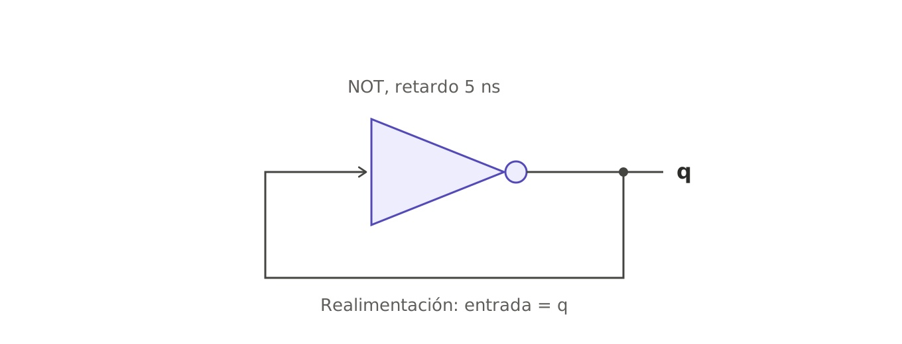
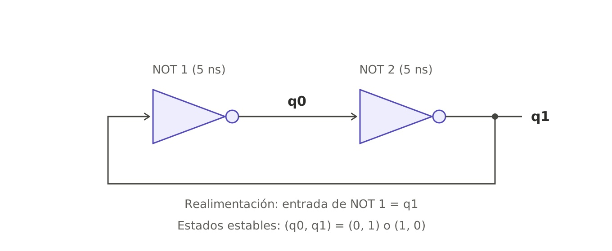

| tiempo (ns) | d | q |
| --- | --- | --- |
|0|0|0|
|5|1|1|
|10|0|0|
|15|1|1|
|20|0|0|
|25|1|1|
|30|0|0|

| tiempo (ns) | q_0 | q_1 |
| --- | --- | --- |
|0|0|0|
|5|1|1|
|10|0|0|
|15|1|1|
|20|0|0|
|25|1|1|
|30|0|0|

Partiendo de (0, 0) con retardos idénticos, no alcanza un estado estable

estado inicial: (q_0, q_1)=(0,1)

| tiempo (ns) | q_0 | q_1 |
| --- | --- | --- |
|0|0|1|
|5|0|1|
|10|0|1|
|15|0|1|
|20|0|1|
|25|0|1|
|30|0|1|

estado inicial: (q_0, q_1)=(1,0)

| tiempo (ns) | q_0 | q_1 |
| --- | --- | --- |
|0|1|0|
|5|1|0|
|10|1|0|
|15|1|0|
|20|1|0|
|25|1|0|
|30|1|0|

