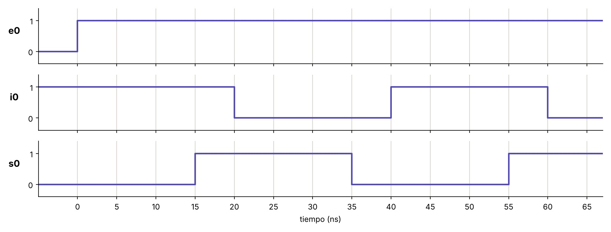

| tiempo (ns) | e0 | i0 | s0 |
| --- | --- | --- | --- |
| 0 | 1 | 1 | 0 |
| 5 | 1 | 1 | 0 |
| 10 | 1 | 1 | 0 |
| 15 | 1 | 1 | 1 |
| 20 | 1 | 0 | 1 |
| 25 | 1 | 0 | 1 |
| 30 | 1 | 0 | 1 |
| 35 | 1 | 0 | 0 |
| 40 | 1 | 1 | 0 |
| 45 | 1 | 1 | 0 |
| 50 | 1 | 1 | 0 |
| 55 | 1 | 1 | 1 |
| 60 | 1 | 0 | 1 |
| 65 | 1 | 0 | 1 |

